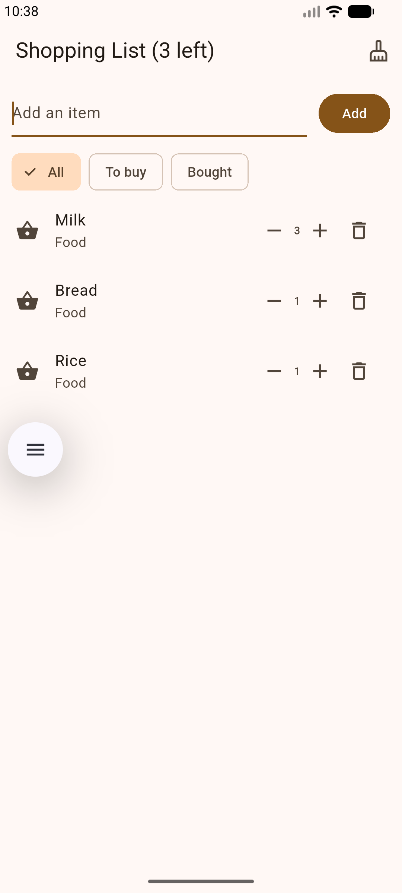
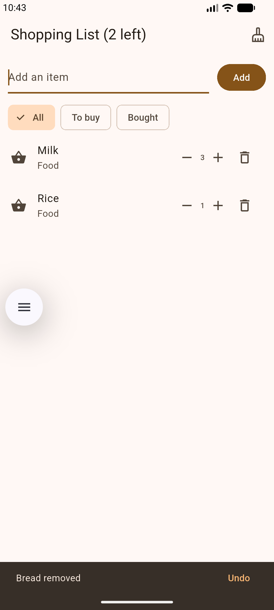
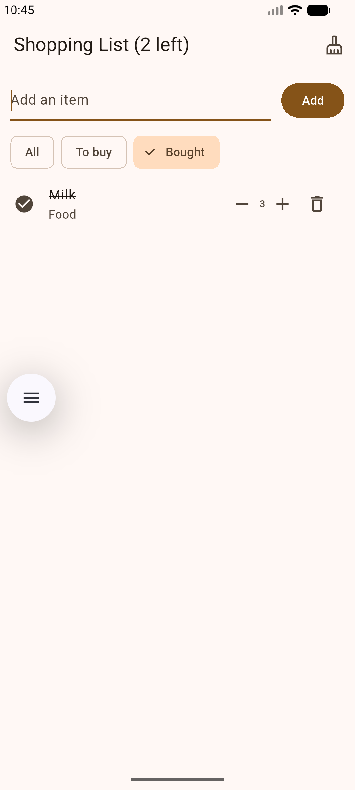
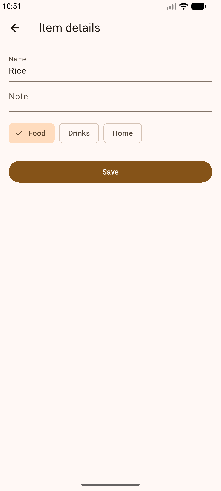

# Shopping List+

A shopping list app. You add items, change how many you need, mark them bought, filter the list, and open each item for its name, note, and category.

## Features

1. **Nothing to show.** When every item is deleted, the page says "Your list is empty". Adding an item brings the list back.
2. **How many?** Each row has −, a quantity, and +. A new item starts at 1. − never goes below 1. The bin removes the item.
3. **No duplicates, just more.** Adding a name that is already on the list, ignoring capitals and extra spaces, adds 1 to that item's quantity and shows a message such as "Milk is already on the list: now ×2".
4. **Undo.** Deleting an item shows "Bread removed" with an Undo button. Undo puts that item back in the same place, with the same quantity and bought status.
5. **Show me what's left.** Chips under the input: All, To buy, and Bought. All shows every item, with bought ones at the bottom. To buy shows only items still to buy. Bought shows only bought items. An empty filter says "Nothing here".
6. **Item details.** A long-press opens Item details. You can change the name, the note, and the category (Food, Drinks, or Home). Save keeps the changes. An empty name is refused. The back arrow leaves the item unchanged. The row shows the category and the note, for example "Home · 1 kg bag".

## Screenshots

Quantities:

Undo:

Bought filter:

Item details:

## Think

1. With a filter on, the rows on screen are a shorter list. Row 0 on the screen is not always item 0 in `items`. Deleting with that screen index removes the wrong item, and there is no error. The bin now finds the real item with `items.indexOf(item)` and removes that one.

2. `final` means the value is set once and cannot be changed. Save has to rename the item, so `final` had to come off `name`. `final` is still a good choice for values that never change, such as the text controller and the screen title.

3. Hot reload keeps the `Item` objects that were already created. Those old objects were built before `quantity` existed, so they have no quantity. A hot restart runs the app from the start and builds new items with the new field. A normal save was enough for other edits because those edits did not change the shape of `Item`.

4. The details screen and the list share the same `Item` object, so Save did change the name. Flutter only redraws a screen when that screen calls `setState`. The list did not call it, so it kept the old text. `.then` runs when the details screen closes, and `setState` there tells the list to draw the new name, note, and category. Flutter redraws when you tell it the state changed, not whenever an object in memory changes.
